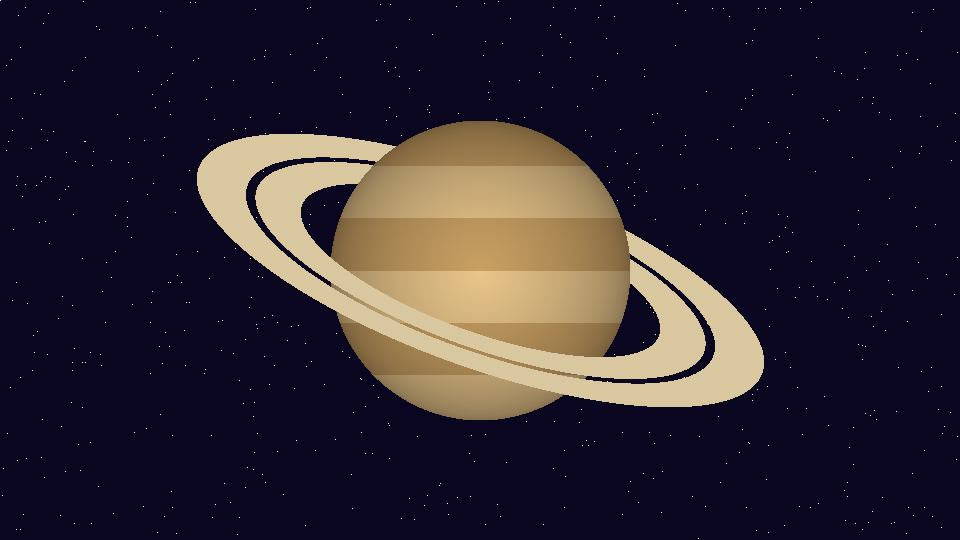

The questions of Quiz Night, in order; text before the first question is
ignored. Each `#` starts a question and each list item is an answer; `[x]`
marks the right ones (several make it multiple choice) and none makes it a
poll. `key: value` lines set `time`, `points`, `mode`, `image`, `right`
(the share of the rehearsal that gets it right) and `votes` (the rehearsal's
weights in a poll). `tools/make_images.py` draws the images.

`main.py` designs each slide by the kind of question; editing this file is
enough to change the trivia.

# Which subject do you know best?
mode: multiple
votes: 4, 3, 2, 3
notes: Icebreaker: more than one can be picked.

- Science
- History
- Art
- Geography

# Which is the hottest planet in the solar system?
time: 20
right: 40%
notes: Venus: its CO₂ atmosphere traps the heat (about 460 °C), even though Mercury is closer to the Sun.

- Mercury
- [x] Venus
- Mars
- Jupiter

# Who painted "The Starry Night"?
time: 15
right: 80%

- [x] Vincent van Gogh
- Claude Monet
- Pablo Picasso
- Salvador Dalí

# Which country's flag is this?

time: 20
right: 45%
notes: Japan has the circle centered on white; Palau, yellow on blue.

- Japan
- [x] Bangladesh
- Palau
- Laos

# Who dropped out of college and founded a company?
time: 25
right: 35%
notes: Gates and Zuckerberg left Harvard; Jobs, Reed College. Bezos graduated from Princeton.

- [x] Bill Gates
- [x] Mark Zuckerberg
- Jeff Bezos
- [x] Steve Jobs

# Which planet is this?

time: 15
right: 85%

- Jupiter
- [x] Saturn
- Uranus
- Neptune

# Which is the tallest building in the world?
time: 20
right: 55%
notes: The Burj Khalifa (Dubai, 2010) is 828 m tall. The race of records comes next.

- [x] Burj Khalifa
- Shanghai Tower
- Taipei 101
- Petronas Towers

# Which chemical element has the symbol Au?
time: 15
right: 65%

- Silver
- [x] Gold
- Argon
- Aluminium

# In which year did people first land on the Moon?
time: 20
right: 60%

- 1965
- [x] 1969
- 1972
- 1959

# What does PDF stand for?
time: 20
right: 50%

- [x] Portable Document Format
- Printed Data File
- Public Digital Form
- Please Download File

# How many bones does an adult have?
time: 20
right: 45%

- 186
- [x] 206
- 226
- 306
